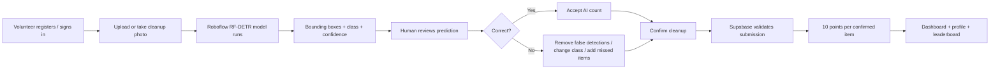
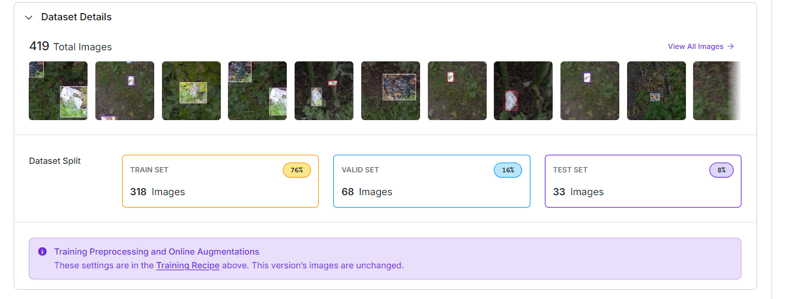
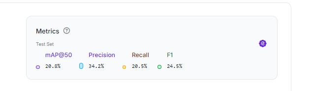
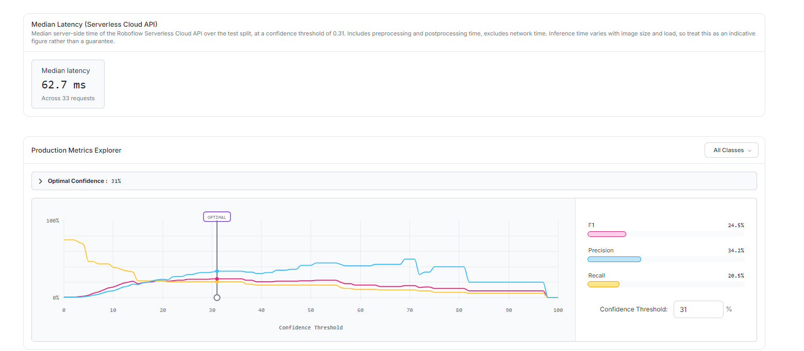
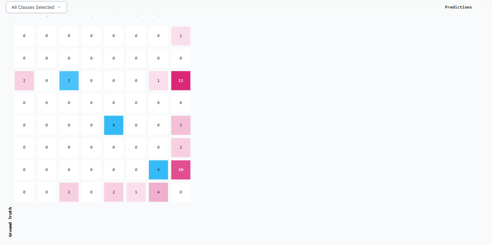
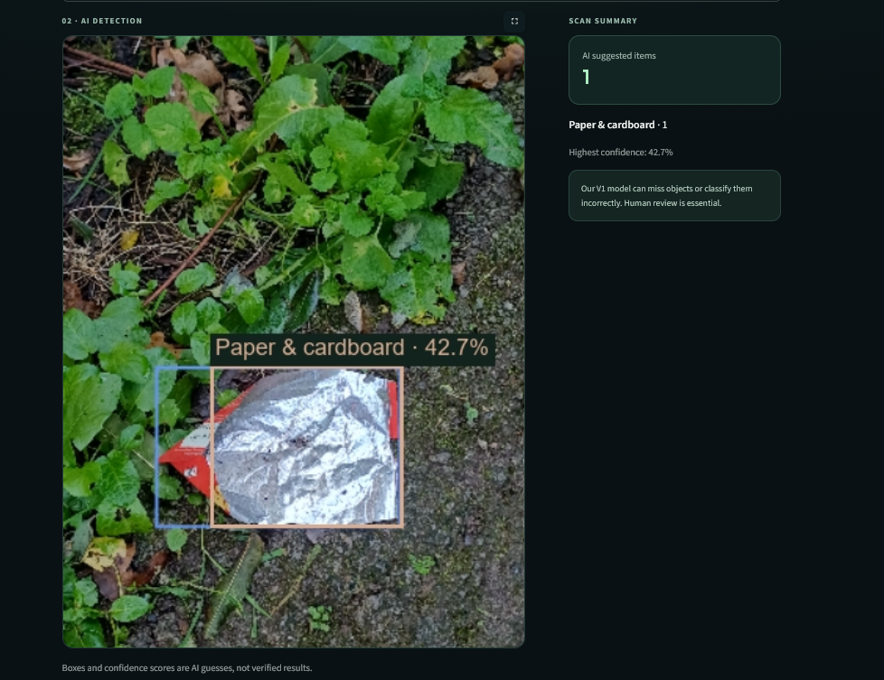
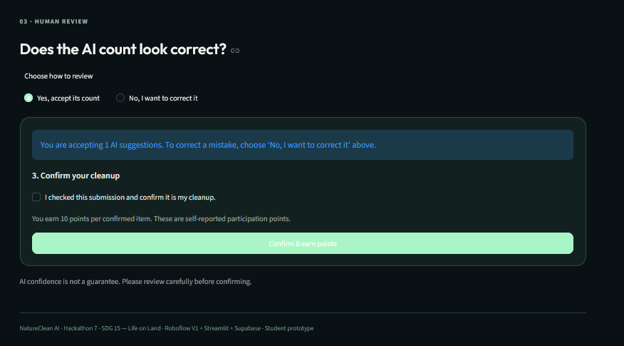
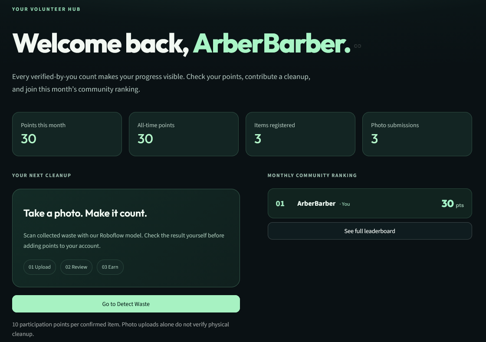
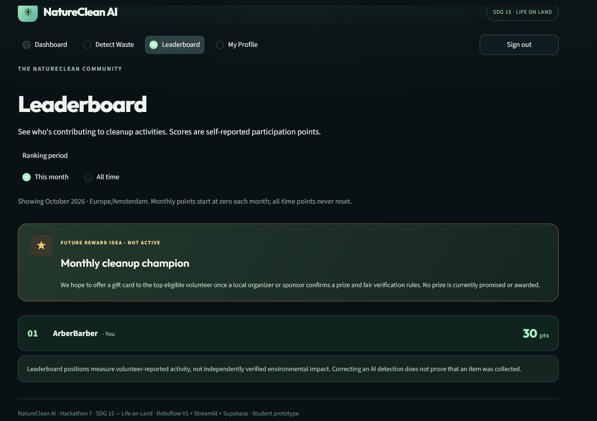
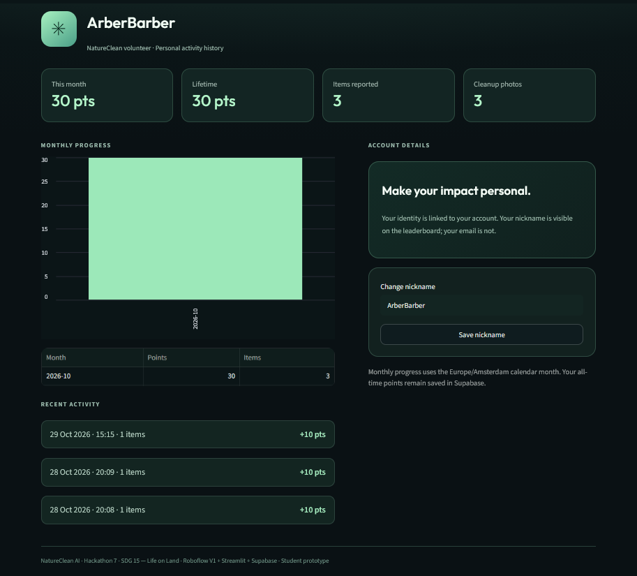

# NatureClean AI - Eyes on Earth

**Hackathon 7 · AI for Good**  
**Required tool:** Roboflow  
**Model:** RF-DETR Small object detection  
**Assigned SDG:** [SDG 15 - Life on Land](https://sdgs.un.org/goals/goal15)  
**Application:** Python + Streamlit + Supabase  
**Dataset:** 419 self-collected and labelled images from the Netherlands in The Hague

**Youtube video:**

---

## Project summary

NatureClean AI is a community-cleanup prototype for people who already pick up litter in parks and green spaces in **The Hague**. A volunteer creates an account, uploads or takes a photo of collected litter, receives an AI-assisted object count from a custom Roboflow model, reviews and corrects the result, and then saves the confirmed cleanup activity. The app awards **10 participation points per confirmed item** and shows monthly and all-time community leaderboards.

The purpose is not to claim that AI can perfectly measure environmental impact. Our model is still weak and sometimes misses or misclassifies litter. Instead, we use computer vision as a **first counting suggestion** and keep the human volunteer responsible for the final confirmed count.

> **Core idea:** make cleanup participation easier to log and more visible, while being transparent that AI predictions and participation points are not proof of environmental impact.

---

## 1. Problem definition

Litter in streets, parks and other public green areas is both a local quality-of-life issue and an environmental problem. During our own data collection in green areas in **The Hague**, we repeatedly found cans, plastic packaging, bottles, paper/cardboard and other waste among plants, paths and soil. Those observations became the basis of our image dataset.

This is also a real local issue rather than a problem invented for the hackathon. The Municipality of The Hague actively asks residents to participate in neighbourhood cleanups and offers support such as cleanup actions and borrowed litter-picking equipment:  
https://www.denhaag.nl/nl/afval/zorgen-voor-een-schone-buurt/

The environmental relevance extends beyond appearance. The Dutch Government states that litter can remain in the environment for a long time, can be eaten by or entangle animals, and estimates that Dutch municipalities, water authorities and other site managers spend around **€280 million per year** addressing litter:  
https://www.rijksoverheid.nl/themas/klimaat-milieu-en-natuur/afval/kunststofafval-in-zee-plastic-soep

Our specific problem is therefore:

> **People already taking part in local cleanups have no simple way in our prototype context to turn a cleanup photo into an AI-assisted item count, review that result, save their activity and compare participation over time.**

We deliberately do **not** claim that a points system has already been proven to increase volunteer participation. That would require a real user pilot. What we built is a working prototype to test that idea.

### Why this fits SDG 15

SDG 15 focuses on protecting terrestrial ecosystems and biodiversity. NatureClean AI addresses a small, local part of that broader goal: reducing litter left in parks and green spaces and supporting people who participate in keeping those spaces clean.

The project does not pretend that one cleanup app can solve biodiversity loss. Its scope is intentionally narrower: **community participation around litter in terrestrial public spaces**.

---

## 2. Intended users

### Primary user

Our main user is a **volunteer participating in a local park, neighbourhood or green-space cleanup in The Hague**.

A typical user:

- has collected one or more pieces of litter;
- has a phone or computer with a camera or photo upload;
- has internet access;
- wants a quick way to record the activity without manually entering every item from scratch;
- is willing to review an imperfect AI result before it is saved;
- may be motivated by visible progress, personal history or a community leaderboard.

### Secondary user

A secondary user is a **community cleanup organiser** who wants to see aggregate participation through a leaderboard. The current prototype exposes public nicknames and aggregated scores, not user email addresses.

### Who this app is not for

NatureClean AI is **not** designed for:

- municipal enforcement;
- issuing fines or penalties;
- scientific measurement of all litter present in an area;
- proving that photographed waste was actually removed;
- automatically distributing real prizes or money;
- making high-stakes decisions about volunteers based on AI output.

Those use cases would require much stronger model performance, fraud prevention, privacy controls and independent verification.

---

## 3. What we built

NatureClean AI is a working Streamlit application with four main areas:

1. **Dashboard** — shows current-month points, all-time points, total reported items and photo submissions.
2. **Detect Waste** — lets a user upload a JPG/PNG or take a camera photo, runs Roboflow inference, displays bounding boxes and confidence values, and asks the user to review the prediction.
3. **Leaderboard** — shows monthly and all-time rankings based on confirmed submissions.
4. **My Profile** — shows personal totals, monthly history, recent activity and an editable public nickname.

User accounts and persistent data are handled with **Supabase Auth + Postgres**. The computer-vision step is handled by the required tool, **Roboflow**.

### End-to-end user flow



### Input → processing → output

| Stage | What happens |
|---|---|
| **Input** | Signed-in volunteer uploads a JPG/PNG image or takes a camera photo. |
| **Validation** | The app checks file type, file size, image size and EXIF orientation. |
| **AI step** | The image is sent to the deployed Roboflow workflow using `inference-sdk`. |
| **Model output** | Roboflow returns detected objects with bounding boxes, classes and confidence scores. |
| **Human review** | User can accept, reject or reclassify detections and manually add objects the model missed. |
| **Confirmation** | User confirms that the submission represents their cleanup. |
| **Scoring** | Supabase calculates `10 × confirmed item count` server-side. |
| **Storage** | Confirmed category counts, points, user ID, timestamp and image fingerprint are stored. The image itself is not stored by this app. |
| **Output** | Updated dashboard statistics, profile history and monthly/all-time leaderboard. |

---

## 4. Why Roboflow is essential

Roboflow is not only mentioned in the project; it performs the core AI task.

We used Roboflow to:

- upload and organise our own image dataset;
- label litter objects with bounding boxes;
- create the train/validation/test split;
- train an **RF-DETR Small** object-detection model;
- evaluate the model using mAP, precision, recall, F1 and confidence-threshold information;
- deploy the trained model in a Roboflow Workflow;
- run inference from the Streamlit application on new images.

Without Roboflow, the app could still contain a manual form, but it would lose the defining feature of the prototype: **AI-assisted detection and counting from a cleanup photo**. The Roboflow output is what creates the suggested objects that the volunteer then reviews.

---

### How we trained the model in Roboflow

The computer-vision model was created entirely through Roboflow using our own collected dataset.

Our training process was:

1. We recorded litter photos and videos in The Hague.
2. Video footage was converted into still images.
3. The images were uploaded to Roboflow.
4. We manually labelled litter objects using bounding boxes.
5. Each object was assigned to one of our seven litter classes.
6. Roboflow created the training, validation and test split.
7. Images were auto-oriented and resized to 512 × 512.
8. Horizontal flip augmentation was applied.
9. We trained an RF-DETR Small object-detection model.
10. We evaluated the model using mAP@50, precision, recall, F1 and the confusion matrix.
11. The best version was deployed through a Roboflow Workflow.
12. Our Streamlit application calls this workflow using the Roboflow inference SDK.

The deployed workflow returns bounding boxes, predicted classes and confidence values. These predictions are then shown to the volunteer for human review before a cleanup submission is saved.

---

## 5. Dataset and labelling

We created our own dataset from **photos and video frames recorded in the Netherlands**. The final V1 dataset contains **419 labelled images**.

The model was trained with seven classes:

- `plastic_bottle`
- `plastic_bag`
- `plastic_packaging`
- `beverage_can`
- `paper_cardboard`
- `glass_bottle`
- `pen`

The application also contains `other_litter` as a manual correction category. This is an app fallback and **not an eighth trained model class**.

### Dataset split



Roboflow split the 419 labelled images into:

| Split | Images | Share |
|---|---:|---:|
| Training | **318** | **76%** |
| Validation | **68** | **16%** |
| Test | **33** | **8%** |

Some images are near-identical frames extracted from the same videos. We tried to keep obvious related frames together during training, but this dataset still has limited diversity in locations, lighting, camera devices and litter appearance. A stronger future dataset should use more independent filming sessions and more locations.

---

## 6. Model training and results

Our deployed **Model V1** uses **RF-DETR Small** for object detection. Images were auto-oriented and resized to **512 × 512 (fit)**, with horizontal flip augmentation during training.

### Test-set metrics



| Metric | V1 result | Interpretation |
|---|---:|---|
| **mAP@50** | **20.8%** | Overall object-detection quality is low. |
| **Precision** | **34.2%** | A substantial share of predictions are incorrect matches. |
| **Recall** | **20.5%** | The model misses many labelled litter objects. |
| **F1** | **24.5%** | Precision and recall are both limited. |

These results are important because they prevent us from overselling the prototype. In particular, **20.5% recall means the model misses many real objects**. That is why the user can manually correct the result before points are awarded.

### Confidence threshold and latency



Roboflow reported an **optimal confidence threshold of 31%** for the shown evaluation and a **median server-side latency of 62.7 ms across 33 requests**.

The latency figure is only the Roboflow server-side measurement shown in the evaluation. It excludes network travel and the rest of the Streamlit/Supabase flow, so we do **not** present it as total end-to-end app latency.

A confidence value is also not a guarantee that a prediction is correct. It is the model's score for its own prediction.

### Confusion matrix



The confusion matrix contains many objects that fall into the background / missed-detection side of the matrix, which is consistent with the low recall score. The original screenshot unfortunately crops part of the class headings, so we do not use it to make precise per-class claims.

### Second training attempt

We also trained a second version using a revised, smaller dataset of **335 images and five classes**. That run reported **9.3% mAP@50** and **8.7% recall**.

However, the dataset and test split were different, so this is **not a controlled model comparison**. We cannot honestly claim that one particular training change caused the lower score. We therefore kept V1 because it performed better on its own reported test set.

---

## 7. Evidence that the model works on a new image

The requirement was not only to train a model, but to run it on new, unseen images.



This screenshot shows the **current V2 application** after a volunteer uploads a cleanup photo. The deployed Roboflow model returns a bounding box, predicted class and confidence score directly inside the Streamlit interface.

In this example, the model suggests **Paper & cardboard** with **42.7% confidence**. The interface also warns that the model can miss objects or classify them incorrectly, which is why the prediction is treated as a suggestion rather than a verified result.

---

## 8. Human review and correction

A central design decision was to make the model a **suggestion system**, not the final authority.



The current V2 review screen requires the volunteer to decide whether the AI count looks correct. The user can either accept the AI suggestion or choose **No, I want to correct it** before continuing.

Before points can be earned, the volunteer must also explicitly confirm that the submission represents their cleanup. Only the **confirmed** total is used for scoring.

This human-in-the-loop design is not just a usability feature. It directly responds to the measured model weakness. With recall at only 20.5%, automatically turning raw AI output into points would create misleading results.

---

## 9. Scoring, accounts and leaderboard

Each confirmed item is worth **10 participation points**.

Important distinction:

> **Points measure self-reported participation. They are not verified proof of how much waste was removed from nature.**

Scoring is calculated inside the database rather than trusted from the browser/client. The SQL trigger in [`supabase/setup.sql`](supabase/setup.sql) validates categories and counts and calculates the score server-side.

The current app includes:

- Supabase email/password authentication;
- a public nickname separate from the user's email;
- monthly points based on the **Europe/Amsterdam** calendar month;
- lifetime points that do not reset;
- personal submission history;
- top-50 leaderboard output containing nickname and aggregate totals;
- Row Level Security for personal records;
- a SHA-256 fingerprint of normalized image pixels to block an **identical image** from earning points twice.

The duplicate check is deliberately described as limited: cropping, recompressing or otherwise changing the image can create a new fingerprint.

### Current V2 account and persistence evidence



The dashboard shows the signed-in volunteer's current-month points, all-time points, registered items, photo submissions and current monthly ranking.



The leaderboard shows monthly and all-time ranking options and displays the volunteer's saved participation points. It also clearly labels the gift-card concept as a **future reward idea - not active**.



The profile shows persistent monthly and lifetime totals together with recent cleanup activity. This provides visible evidence that confirmed activity is stored and reflected in the user's account.

### Future gamification: monthly reward

The leaderboard is currently used only for participation points and ranking. A future version could add a **small gift card for the volunteer who finishes #1 on the monthly leaderboard**. The purpose would be to add an extra gamification incentive and make repeated cleanup participation more engaging.

We would **not enable a real reward yet**. Because a prize gives users a stronger reason to manipulate submissions, real rewards should only be introduced after stronger verification and anti-fraud controls are in place.

---

## 10. Problem–solution fit

A simpler solution would be a form where volunteers manually type how many items they collected. That would technically record cleanup activity, but it would not test the hackathon's computer-vision idea and would make users manually count and categorise every object from scratch.

Our approach fits the problem because:

- the **photo** is already a natural thing for a volunteer to capture after a cleanup;
- Roboflow turns that photo into an immediate first count;
- the volunteer does not need to start from an empty form;
- human review limits the damage caused by model mistakes;
- saved history makes repeated participation visible;
- the leaderboard explores whether community visibility can make participation more engaging.

At the same time, we do not claim that the leaderboard is proven to change behaviour. That is a hypothesis for future user testing, not an established result.

---

### Why volunteers would use NatureClean AI

NatureClean AI is designed not only to record cleanup activities, but also to make participation more engaging.

For a volunteer, the app provides several reasons to keep using it:

- the Roboflow model gives a first estimate of the collected litter, reducing the amount of manual counting;
- personal statistics make the volunteer's contribution visible over time;
- participation points give immediate feedback after a cleanup;
- the monthly leaderboard introduces a competitive and social element;
- in a future version, the volunteer who finishes #1 on the monthly leaderboard could receive a small gift card.

The gift card is intended as an additional gamification incentive. The idea is that visible progress, competition and a possible reward could encourage volunteers to participate in more cleanup activities.

However, this has not yet been tested with real users. We therefore treat increased participation as a hypothesis rather than a proven effect. Real rewards would only be introduced after stronger anti-fraud controls and human review are in place.

---

## 11. Technical architecture

| Component | Role |
|---|---|
| **Roboflow** | Dataset management, labelling, RF-DETR training, evaluation and deployed object-detection workflow. |
| **Streamlit (`app.py`)** | User interface, authentication flow, image upload/camera input, inference call, visualisation and review UI. |
| **`core.py`** | Parses Roboflow workflow responses, cleans predictions and converts reviewed predictions into confirmed counts. |
| **Supabase (`cloud.py`)** | Authentication, profiles, submissions, statistics, history and leaderboard calls. |
| **Postgres (`supabase/setup.sql`)** | Data schema, validation, server-side scoring, RLS policies and leaderboard/statistics functions. |
| **Pillow** | Image validation, EXIF correction, normalization and bounding-box drawing. |
| **Pytest** | Offline tests for parsing, count validation, scoring behaviour and helper functions. |

### Repository structure

```text
NatureClean_AI/
├── app.py
├── cloud.py
├── core.py
├── style.css
├── requirements.txt
├── .env.example
├── START_WINDOWS.bat
├── SETUP_GUIDE.md
├── supabase/
│   └── setup.sql
├── tests/
│   ├── test_cloud.py
│   └── test_core.py
├── evidence/
│   ├── confidence_and_latency.png
│   ├── confusion_matrix.png
│   ├── dataset_split.png
│   ├── model_v1_metrics.png
│   ├── v2_ai_detection.png
│   ├── v2_human_review.png
│   ├── v2_dashboard.png
│   ├── v2_leaderboard.png
│   ├── v2_profile.png
│   └── README.md
└── README.md
```

---

## 12. How to run the prototype

### Requirements

- Python **3.11+**
- internet connection
- a Roboflow API key with access to the workflow
- a Supabase project

### 1. Install dependencies

```bash
python -m pip install -r requirements.txt
```

### 2. Configure Supabase

Create a Supabase project and run the complete contents of:

```text
supabase/setup.sql
```

in **Supabase → SQL Editor**.

Enable email/password authentication.

### 3. Configure environment variables

Copy `.env.example` to `.env` and fill in your own values:

```env
SUPABASE_URL=https://your-project.supabase.co
SUPABASE_PUBLISHABLE_KEY=your_publishable_key
ROBOFLOW_API_KEY=your_roboflow_api_key
ROBOFLOW_WORKSPACE=arbrs-workspace
ROBOFLOW_WORKFLOW_ID=natureclean-ai-vnatureclean-ai-1-rfdetr-small-t1-logic
```

Do **not** commit `.env`, passwords, secret keys or a Supabase `service_role` key.

### 4. Start Streamlit

```bash
python -m streamlit run app.py
```

On Windows, `START_WINDOWS.bat` can also be used after dependencies are installed.

### 5. Demo the complete flow

1. Create an account and choose a public nickname.
2. Sign in.
3. Open **Detect Waste**.
4. Upload an unseen JPG/PNG or take a camera photo.
5. Wait for the Roboflow model result.
6. Review the boxes, categories and confidence values.
7. Accept the suggestions or choose **No, I want to correct it**.
8. Remove false detections, change classes and/or add missed litter.
9. Confirm the cleanup.
10. Submit and check the updated Dashboard, My Profile and Leaderboard.
11. Try submitting the identical photo again to see duplicate scoring blocked.

More setup and troubleshooting details are in [`SETUP_GUIDE.md`](SETUP_GUIDE.md).

---

## 13. Verification and tests

The repository includes offline tests for prediction parsing, corrections, input validation and scoring-related helper logic.

Run:

```bash
python -m pytest -q
```

For the submitted archive, the current offline test suite returns:

```text
9 passed
```

These tests are useful, but they are **not a substitute for a live end-to-end test**. A complete demonstration still requires valid Roboflow and Supabase credentials and a real signed-in submission.

---

## 14. Ethical reflection / data card

### What data did we collect?

We collected our own litter photos and video frames in the Netherlands and labelled litter objects with bounding boxes. The V1 dataset contains 419 images across seven trained classes.

### Main limitation: weak model performance

The model has **20.5% recall**, meaning many labelled objects are missed. It also produces false positives and wrong categories. If raw predictions directly controlled points, users with difficult lighting, unusual litter or underrepresented classes could receive systematically worse scores.

**Mitigation:** the user reviews every result and can reject, reclassify or add objects before submission.

### Dataset bias and generalisation

Our images come from a limited set of Dutch environments and include near-duplicate video frames. This can make test performance look more representative than it really is and may not generalise to different parks, seasons, phones, lighting conditions or types of litter.

**Next step:** collect more independent images across different locations, weather, seasons and devices, and evaluate on a truly separate test set.

### False sense of accuracy

Bounding boxes and confidence percentages can make AI output look more certain than it is.

**Mitigation:** the interface explicitly says that confidence is not a guarantee and requires human review before scoring.

### Fairness of points

A user whose litter is missed by the model may need to do more manual correction than another user. This can make the system feel unfair even if correction is available.

**Mitigation:** points are based on the final human-confirmed count, not directly on AI detections. We also call them **participation points**, not verified environmental impact.

### Fraud and duplicate submissions

A photo does not prove that the waste was actually collected. A user can also exaggerate manual counts. The app blocks identical normalized images using a SHA-256 fingerprint, but edited or cropped duplicates can bypass this.

**Mitigation:** no real reward is active. Before introducing prizes, a real deployment would need stronger verification and **a human organiser/moderator who can review suspicious submissions before rewards are approved**. This person could check unusual point increases, repeated or near-duplicate photos, implausible manual corrections, and other submissions that look inconsistent.

### Privacy

Cleanup photos may accidentally include faces, addresses, license plates or other identifiable information. Images are sent to Roboflow for inference.

**Mitigation:** users should avoid uploading identifiable or sensitive content. Public leaderboards use nicknames rather than email addresses. A real deployment would also require a clear retention/privacy policy and review of the cloud provider's data handling.

### Appropriate use

Because of the current error rate and verification limitations, NatureClean AI should **not** be used for fines, public funding decisions, environmental compliance, scientific litter inventories or any other high-stakes decision.

---

## Who did what?

| Partner | Contribution |
|---|---|
| **Arbër Deda** | Took the photos used for the dataset, reviewed Rayna's labels and approved or rejected images, configured Supabase and the API key integration, and built the website and application code. |
| **Rayna Jong** | Used Gemini Argon 4 in Roboflow to label the photos and trained the model with the approved images. |
| **Together** | Reviewed and finalized the README and PowerPoint presentation together. |

---

## 15. What worked and what we learned

The project successfully connects a custom-trained Roboflow model to a usable application instead of stopping at a training dashboard. We learned that getting a model to produce a bounding box is only one part of a useful AI system. The harder question is what to do when the prediction is wrong.

Our own model metrics forced us to change the product design. Instead of automatically awarding points from AI output, we introduced human review and manual corrections. That made the limitations of the model part of the design rather than something hidden from the user.

We also learned that a second training run with a lower score is not enough evidence to identify the cause. Because the second version used a different dataset and test split, we cannot make a fair apples-to-apples claim about which training change helped or hurt.

---

## 16. What we would improve next

1. **Collect more diverse data** from more parks, neighbourhoods, phones, seasons and lighting conditions.
2. **Improve class balance** so uncommon litter categories are better represented.
3. **Create a stronger independent test set** without near-duplicate video frames.
4. **Test with real volunteers** to find out whether AI-assisted logging is actually faster or more motivating than manual entry.
5. **Measure correction effort**: how often users reject, change or add detections.
6. **Add a human anti-fraud review role** - an organiser/moderator should review suspicious submissions and approve questionable cases before any real prize is awarded.
7. **Review cloud privacy and retention** before public deployment.
8. **Capture a final V2 submission-success screenshot** immediately after a confirmed cleanup, so the success state itself is also documented.
9. **Pilot the monthly gift-card incentive** - after stronger fraud controls are implemented, test whether giving a small gift card to the monthly #1 volunteer actually increases participation without encouraging abuse.

---

## Final statement

NatureClean AI demonstrates a complete **AI-assisted cleanup logging workflow** rather than only a trained computer-vision model. The most important lesson from the project is also visible in the product design: our AI is useful, but it is not reliable enough to make the final decision. The model proposes; the user verifies.
