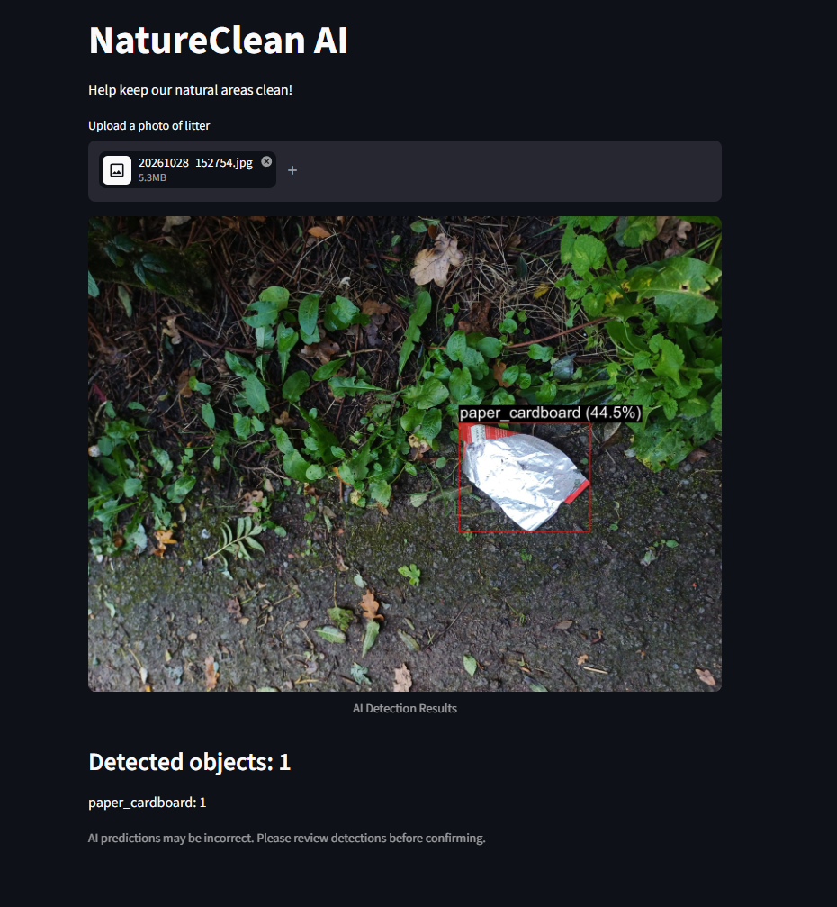
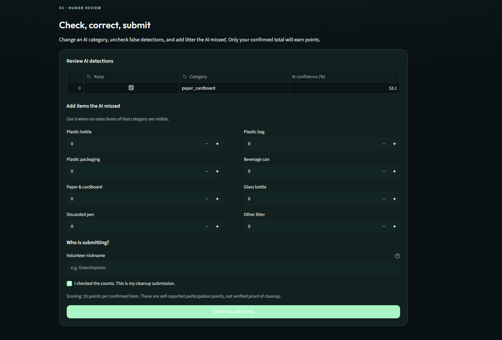

# NatureClean AI — model evidence and implementation notes

These screenshots come from the Roboflow project and the Streamlit prototype used during Hackathon 7. **The screenshots of the early Streamlit interface document development, not the final V2 account interface.** The runnable app code is in the project root.

## 1. Problem, audience and the chosen approach

During data collection in green areas in The Hague, we photographed cans, packaging and other litter among vegetation and paths. The intended user is someone already participating in a local park or green-space cleanup who wants to log an activity and see their participation over time. The secondary audience is a community organiser viewing the leaderboard. The app is not intended for environmental officers who require verified cleanup records, nor for a location-wide litter inventory.

The municipality [encourages residents to help keep neighbourhoods clean](https://www.denhaag.nl/nl/afval/zorgen-voor-een-schone-buurt/); this establishes a relevant local setting, but it **does not prove** that points improve volunteering. That would require a small pilot and feedback from real volunteers. We chose photo-based counting because manually entering every item is repetitive. The model suggests a first count; volunteers can correct it, so detection errors do not automatically determine points.

## 2. Own dataset and labelling

The dataset includes **419 labelled images** from original Dutch photos and video frames. We reviewed automatic annotations in Roboflow and used seven classes: `plastic_bottle`, `plastic_bag`, `plastic_packaging`, `beverage_can`, `paper_cardboard`, `glass_bottle`, and `pen`. The app additionally lets people record `other_litter` manually; that does **not** imply the trained model has an eighth category.

- **Training:** 318 images (76%).
- **Validation:** 68 images (16%).
- **Test:** 33 images (8%).
- Several frames came from the same videos. These were grouped within training to reduce obvious video-frame leakage, but the collection still contains limited variation. Separate filming sessions and locations would provide a stronger generalisation test.

## 3. Training and evaluation

Model V1 uses **Roboflow RF-DETR Small** for object detection. Images were auto-oriented and resized to 512 × 512 (fit), with horizontal flip augmentation during training. The model returns predicted boxes, category labels and per-detection confidence values. A confidence score describes the model's own output; it is not a verified probability of correctness.

| Test metric | V1 result | What it says in practice |
|---|---:|---|
| mAP@50 | 20.8% | Object detection quality is low overall. |
| Precision | 34.2% | Many predicted objects are not correct matches. |
| Recall | 20.5% | The model misses many real labelled objects. |
| F1 | 24.5% | Precision and recall are both limited. |

Roboflow marked **31%** as the best F1 threshold for this evaluation. Median server-side inference latency was **62.7 ms across 33 requests** (excluding network travel and the rest of the app). It should not be interpreted as end-to-end upload time.

### Confusion matrix

The matrix shows numerous missed ground-truth objects in the background / false-negative column. This is consistent with the low recall. **The original screenshot cuts off part of the class labels**, so it is not suitable for a precise per-class comparison. A complete Roboflow export should replace it if available.

We also trained a second version with a revised, smaller dataset (335 images, five classes). Its reported mAP@50 was **9.3%** and recall **8.7%**, but the dataset and test split differed. We cannot conclude that the architecture or every change made the result worse from this comparison alone. We retained the better-performing V1 for the prototype.

## 4. Working proof: image in, decision out

### Detection on an unseen upload

An earlier version of our Streamlit app sent a new photograph to the deployed V1 Roboflow workflow. The model found an item and drew its box with a class and confidence. In this example, the label `paper_cardboard` was not obviously correct for the pictured packaging. This is a practical example of **why accepting predicted labels automatically would be unreliable**.

### Human review before points

The prototype allows a volunteer to keep or reject suggested objects, change categories and manually add waste the model missed. In the latest app, users can accept the result or choose **No, I want to correct it**. The database computes **10 points per confirmed item** and stores the submission under the signed-in account. Users can view monthly and all-time leaderboards; the month is calculated from stored submission dates rather than erasing lifetime totals.

The code uses a normalised image fingerprint to block identical-photo submissions. This does **not** prevent modified copies or fabricated counts. We do not treat participation scores as proof of waste removal, and the proposed gift-card reward is **not active**.

## 5. Implementation and verification

| Stage | Implementation |
|---|---|
| Identity | Supabase Auth with email and password, plus a public nickname. |
| Input | Streamlit JPG/PNG uploader or camera input, with image-size checks and EXIF correction. |
| Detection | `app.py` calls the Roboflow V1 Workflow through `inference-sdk` using an API key from `.env`. |
| Correction | `core.py` parses the model response and computes the user's corrected counts. |
| Scoring | A SQL trigger in `supabase/setup.sql` validates counts and calculates points on the server. |
| History | Supabase submission dates provide monthly and lifetime totals. |
| Access controls | RLS restricts personal records. The leaderboard exposes nicknames and aggregated scores. |

The supplied Python tests cover the parsing and scoring helper behaviour, but **they are not evidence of a full live end-to-end test** with a registered user. For the final GitHub portfolio, the best additional proof would be a screenshot of the V2 app **after confirming a submission**, followed by the leaderboard showing the new points.

## 6. Ethical limits and next steps

The most immediate harm is **misleading activity scores**, particularly when some waste types receive more false negatives than others. A volunteer collecting real litter may earn fewer suggested points than another user with a clearer photo. The correction form helps but shifts responsibility onto users, and it is open to deliberate exaggeration. Privacy also matters: images can contain faces or other identifiable information and are sent for cloud processing. We warn users to avoid faces and use nicknames publicly. Before a real community rollout, we would collect more diverse data, review retention and deletion of images, test with volunteers who use different phones, and require independent confirmation for any real rewards.

## Evidence checklist for final submission

- [x] Dataset split and model-test metrics.
- [x] V1 confusion matrix (original partially cropped screenshot).
- [x] Example detection on an unseen photo from the earlier Streamlit build.
- [x] Review/correction interface from the earlier build.
- [ ] Final V2 submission receipt and updated monthly leaderboard from a real account.
- [ ] Complete confusion-matrix screenshot with all labels visible, if available.
